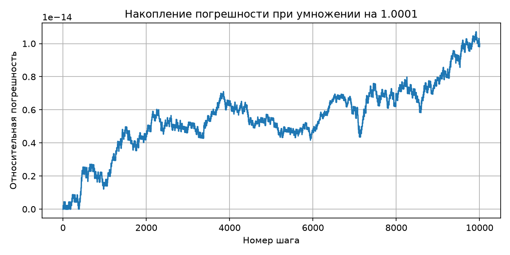

# Домашнее задание № 2

## Что надо было сделать

Абсолютная и относительная погрешность. Округление и накопление ошибки.

**Формат сдачи:** файл `.py` (или `.ipynb`) с решениями и короткие выводы по каждой задаче (2–3 предложения).

## Блок 1. Абсолютная и относительная погрешность (задачи 1–5)

### Задача 1. Ручной счёт

Даны приближённые и точные значения. Для каждой пары вычислите абсолютную погрешность $\Delta x$ и относительную $\delta x$ (в %):

1. $x = 3.14$, $x^* = \pi$.
2. $x = 2.718$, $x^* = e$.
3. $x = 9.8$, $x^* = 9.81$ (ускорение свободного падения).
4. $x = 0.333$, $x^* = 1/3$.

*Вывод:* расположите пары по «качеству» приближения. Совпадает ли порядок по $\Delta x$ и по $\delta x$? Если нет — объясните почему.

### Задача 2. Сравнение несопоставимых величин

Инженер измерил:

- длину моста: $x = 1247$ м при точном 1250 м;
- диаметр болта: $x = 9.7$ мм при точном 10.0 мм.

Вычислите $\Delta x$ и $\delta x$ для обоих. Кто ошибся «сильнее»? Почему ответ зависит от того, какую погрешность мы выбрали? Сформулируйте вывод в 2–3 предложениях.

### Задача 3. Функция `relative_error`

Напишите функцию:

```python
def relative_error(approx, exact):
    return abs(approx - exact) / abs(exact)
```

Добавьте защиту: если `exact == 0`, вернуть `float('inf')` и не падать с `ZeroDivisionError`. Проверьте на четырёх парах из задачи 1.

### Задача 4. Обратная задача — оценка точного значения

Известно, что приближение $x = 47.3$ имеет относительную погрешность не более 0.1%. В каком диапазоне лежит $x^*$? Запишите ответ в виде интервала $[a, b]$ с разумным числом значащих цифр.

### Задача 5. Порог по абсолютной и относительной ошибке

Есть два датчика температуры. Датчик A врёт с абсолютной ошибкой не более 0.3 °C, датчик B — с относительной ошибкой не более 0.5%. При какой температуре датчик B точнее (в смысле $\Delta \le 0.3$)? Решите неравенство $\lvert T\rvert \cdot 0.005 \le 0.3$ и объясните, почему выбор датчика зависит от диапазона измерений.

## Блок 2. Значащие цифры и округление (задачи 6–9)

### Задача 6. Подсчёт значащих цифр

Для каждого числа определите количество значащих цифр и запишите в экспоненциальной форме так, чтобы количество значащих цифр было однозначным:

1. 0.004520
2. 1200
3. 1.200
4. 10.03
5. 0.03050
6. 250000

*Вывод:* в каких случаях запись без экспоненциальной формы неоднозначна и почему?

### Задача 7. Честная запись результата

Измерение дало $x = 4.738291$ с абсолютной погрешностью $\Delta = 0.02$. Запишите результат в виде $x \pm \Delta$, оставив только верные значащие цифры (правило: последняя оставляемая цифра должна быть в том же разряде, что и погрешность). Сколько значащих цифр осталось? Что было бы неверно в записи $4.738291 \pm 0.02$?

### Задача 8. Округление и banker's rounding

Проверьте в Python:

```python
print(round(0.5), round(1.5), round(2.5), round(3.5),
      round(-0.5), round(-1.5), round(-2.5))
```

Объясните, почему результат отличается от «школьного» правила «0.5 всегда вверх». Посчитайте, какой систематический сдвиг накопится на массиве из $10^6$ чисел, каждое из которых — случайное $k + 0.5$ для $k = 0, \ldots, 9$, если округлять «вверх» вместо banker's rounding. Сделайте вывод, почему в финансах это критично.

### Задача 9. Промежуточное округление — зло

Вычислите двумя способами $S = \sum_{k=1}^{100} 1/k$:

- (а) без промежуточных округлений (`float`);
- (б) с округлением каждого слагаемого до 3 знаков после запятой.

Сравните с эталоном `math.fsum` и посчитайте $\Delta S$ и $\delta S$ для обоих вариантов. Во сколько раз ошибка варианта (б) больше? Сформулируйте правило.

## Блок 3. Накопление ошибки и float-эксперименты (задачи 10–15)

### Задача 10. Классика 0.1 + 0.2

Выведите `0.1 + 0.2`, сравните с `0.3` через `==` и через `math.isclose`. Найдите $\Delta$ и $\delta$ этого расхождения. Объясните в 3 предложениях (без формул, «на пальцах»), почему 0.1 не представимо точно в двоичной системе.

### Задача 11. Катастрофическая потеря точности

Вычислите $a - b$ для $a = 1 + 10^{-15}$, $b = 1$. Ожидаемый ответ — $10^{-15}$. Сравните с фактическим результатом в Python. Посчитайте относительную погрешность результата. Затем перепишите квадратичную формулу для корней $ax^2 + bx + c = 0$ при $a = 1$, $b = 10^8$, $c = 1$ так, чтобы избежать вычитания близких чисел, и покажите, насколько точнее получается меньший корень.

### Задача 12. Накопление в цикле — сравнение стратегий

Сложите массив из $10^6$ элементов `[0.1] * 1_000_000` тремя способами:

1. наивный цикл `for x in arr: total += x`;
2. `sum(arr)`;
3. `math.fsum(arr)`.

Сравните с эталоном `1e5`. Для каждого способа посчитайте абсолютную и относительную погрешность. Постройте таблицу и сделайте вывод: какой способ и во сколько раз точнее.

### Задача 13. Суммирование в правильном порядке

Возьмите массив из $10^6$ чисел: половина — очень маленькие (`1e-10`), половина — большие (`1e6`). Посчитайте сумму в порядке:

- (а) сначала маленькие, потом большие;
- (б) сначала большие, потом маленькие.

Сравните с `math.fsum`. Объясните, почему порядок влияет на точность и какая стратегия лучше (подсказка: «маленькие числа теряются, когда прибавляются к большим»).

### Задача 14. Детектор накопления погрешности

Реализуйте «эксперимент с ростом»:

```python
x = 1.0
for _ in range(10_000):
    x *= 1.0001
```

Сравните с эталоном `math.exp(10000 * math.log(1.0001))`. Посчитайте $\delta x$ итерационно — на каком шаге относительная погрешность превысит $10^{-9}$, $10^{-6}$, $10^{-3}$? Постройте график $\delta x$ от номера шага (`matplotlib`). Сделайте вывод: как быстро «раздувается» ошибка в мультипликативных процессах.

### Задача 15. Финансы: float vs Decimal

Смоделируйте начисление 0.01 рубля на счёт $10^6$ раз подряд (это примерно 10 000 рублей):

- (а) в `float`;
- (б) в `Decimal` с точностью 28 знаков.

Сравните результаты и посчитайте расхождение в рублях и в процентах. Какой результат «правильный» с точки зрения бухгалтерии? Дополнительно реализуйте учёт в целых копейках (`int`) и покажите, что он точнее `float`. Сделайте вывод: почему в финансовых системах не используют `float`.

## Бонус (по желанию)

### Задача 16. Мини-исследование

Сгенерируйте $10^5$ случайных `float` в диапазоне $[0, 1)$ и посчитайте среднее тремя способами (цикл, `sum`, `math.fsum`) и через `numpy.mean`. Сравните расхождения между ними в единицах $\varepsilon_{\mathrm{machine}} \approx 2.2 \cdot 10^{-16}$. Оформите короткий отчёт: какой метод точнее и почему `numpy` обычно хорош, но не всегда равен `fsum`.

*Главное, что проверяется: не «получить правильное число», а уметь объяснить, почему оно такое и насколько ему можно верить.*

## Решение

### Задача 1. Ручной счёт

```python
import math

def absolute_error(approx, exact):
    return abs(approx - exact)


def relative_error(approx, exact):
    if exact == 0:
        return float('inf')
    return absolute_error(approx, exact) / abs(exact)


def percentage_error(approx, exact):
    return relative_error(approx, exact) * 100


pairs = [("π", 3.14, math.pi), ("e", 2.718, math.e),
         ("g", 9.8, 9.81), ("1/3", 0.333, 1 / 3)]
for name, approx, exact in pairs:
    print(f"{name}: Δx = {absolute_error(approx, exact):.8f}; "
          f"δx = {percentage_error(approx, exact):.6f}%")
by_absolute = sorted(pairs, key=lambda p: absolute_error(p[1], p[2]))
by_relative = sorted(pairs, key=lambda p: relative_error(p[1], p[2]))
print("По Δx (от лучшего):", " → ".join(p[0] for p in by_absolute))
print("По δx (от лучшего):", " → ".join(p[0] for p in by_relative))
```

```text
π: Δx = 0.00159265; δx = 0.050696%
e: Δx = 0.00028183; δx = 0.010368%
g: Δx = 0.01000000; δx = 0.101937%
1/3: Δx = 0.00033333; δx = 0.100000%
По Δx (от лучшего): e → 1/3 → π → g
По δx (от лучшего): e → π → 1/3 → g
```

**Вывод:** По Δx лучшее приближение — e, затем 1/3, π и g. По δx порядок другой: e, π, 1/3, g, так как важен масштаб значения.

### Задача 2. Сравнение несопоставимых величин

```python
def absolute_error(approx, exact):
    return abs(approx - exact)


def relative_error(approx, exact):
    if exact == 0:
        return float('inf')
    return absolute_error(approx, exact) / abs(exact)


def percentage_error(approx, exact):
    return relative_error(approx, exact) * 100


pairs = [("Мост", 1247, 1250, "м"), ("Болт", 9.7, 10.0, "мм")]
for name, approx, exact, unit in pairs:
    print(f"{name}: Δx = {absolute_error(approx, exact):g} {unit}; "
          f"δx = {percentage_error(approx, exact):g}%")
```

```text
Мост: Δx = 3 м; δx = 0.24%
Болт: Δx = 0.3 мм; δx = 3%
```

**Вывод:** Ошибка моста больше в абсолютных единицах: 3000 мм против 0.3 мм. Болт измерен хуже относительно своего размера: 3% против 0.24%.

### Задача 3. Функция relative_error

```python
import math

def absolute_error(approx, exact):
    return abs(approx - exact)


def relative_error(approx, exact):
    if exact == 0:
        return float('inf')
    return absolute_error(approx, exact) / abs(exact)


pairs = [(3.14, math.pi), (2.718, math.e), (9.8, 9.81), (0.333, 1 / 3)]
for approx, exact in pairs:
    print(f"x = {approx:g}: δx = {relative_error(approx, exact):.8f}")
print("exact = 0:", relative_error(10, 0))
```

```text
x = 3.14: δx = 0.00050696
x = 2.718: δx = 0.00010368
x = 9.8: δx = 0.00101937
x = 0.333: δx = 0.00100000
exact = 0: inf
```

**Вывод:** Результат функции — погрешность в долях; для процентов его умножают на 100. При exact = 0 функция возвращает inf.

### Задача 4. Обратная задача — оценка точного значения

```python
x = 47.3
delta = 0.1 / 100
a = x / (1 + delta)
b = x / (1 - delta)
print("x* ∈ [47.3 / 1.001; 47.3 / 0.999]")
print(f"Приближённо: [{a:.6f}; {b:.6f}]")
```

```text
x* ∈ [47.3 / 1.001; 47.3 / 0.999]
Приближённо: [47.252747; 47.347347]
```

**Вывод:** Точное значение примерно в интервале [47.252747; 47.347347]. Границы несимметричны, так как относительная погрешность зависит от x*.

### Задача 5. Порог по абсолютной и относительной ошибке

```python
error_a = 0.3
error_b = 0.5 / 100
limit = error_a / error_b
print(f"T ∈ [{-limit:g}; {limit:g}] °C")
```

```text
T ∈ [-60; 60] °C
```

**Вывод:** При |T| < 60 °C точнее датчик B, при |T| > 60 °C — A. На границах ±60 °C их предельные ошибки равны.

### Задача 6. Подсчёт значащих цифр

```python
numbers = ["0.004520", "1200", "1.200", "10.03", "0.03050", "250000"]
for number in numbers:
    digits = number.replace(".", "").lstrip("0")
    count = len(digits)
    label = str(count)
    if "." not in number:
        count = len(digits.rstrip("0"))
        label = f"{count}–{len(digits)}"
    print(f"{number}: {label} значащих цифр; {float(number):.{count - 1}E}")
print("Для 1200 и 250000 показана запись с 2 значащими цифрами.")
```

```text
0.004520: 4 значащих цифр; 4.520E-03
1200: 2–4 значащих цифр; 1.2E+03
1.200: 4 значащих цифр; 1.200E+00
10.03: 4 значащих цифр; 1.003E+01
0.03050: 4 значащих цифр; 3.050E-02
250000: 2–6 значащих цифр; 2.5E+05
Для 1200 и 250000 показана запись с 2 значащими цифрами.
```

**Вывод:** У 1200 возможны 2–4 значащие цифры, у 250000 — 2–6: роль конечных нулей неясна. Экспоненциальная запись устраняет эту неоднозначность; у остальных чисел по 4 значащие цифры.

### Задача 7. Честная запись результата

```python
x = 4.738291
delta = 0.02
result = round(x, 2)
print(f"x = {result:.2f} ± {delta:.2f}")
print("Значащих цифр:", len(str(result).replace(".", "")))
```

```text
x = 4.74 ± 0.02
Значащих цифр: 3
```

**Вывод:** Результат — 4.74 ± 0.02, то есть 3 значащие цифры. Остальные разряды в исходной записи не соответствуют точности измерения.

### Задача 8. Округление и banker's rounding

```python
import math
import random

print(round(0.5), round(1.5), round(2.5), round(3.5),
      round(-0.5), round(-1.5), round(-2.5))
rng = random.Random(42)
shift_up = 0.0
shift_even = 0.0
for _ in range(1_000_000):
    x = rng.randrange(10) + 0.5
    shift_up += math.floor(x + 0.5) - x
    shift_even += round(x) - x
print(f"Сдвиг при округлении вверх: {shift_up:g}")
print(f"Сдвиг при округлении к чётному: {shift_even:g}")
print(f"Разность результатов: {shift_up - shift_even:g}")
```

```text
0 2 2 4 0 -2 -2
Сдвиг при округлении вверх: 500000
Сдвиг при округлении к чётному: 69
Разность результатов: 499931
```

**Вывод:** При точной половине round выбирает чётное целое. Округление вверх даёт сдвиг +500000, а к чётному — +69 на этой выборке при нулевом ожидаемом сдвиге. Систематическая ошибка искажает денежные итоги.

### Задача 9. Промежуточное округление

```python
import math

def absolute_error(approx, exact):
    return abs(approx - exact)


def relative_error(approx, exact):
    if exact == 0:
        return float('inf')
    return absolute_error(approx, exact) / abs(exact)


terms = [1 / k for k in range(1, 101)]
exact = math.fsum(terms)
total = 0.0
rounded = 0.0
for x in terms:
    total += x
    rounded += round(x, 3)
print(f"Эталон: {exact:.16f}")
for name, value in [("Без округлений", total), ("С округлением", rounded)]:
    print(f"{name}: S = {value:.16f}; ΔS = {absolute_error(value, exact):.6e}; "
          f"δS = {relative_error(value, exact):.6e}")
error = absolute_error(total, exact)
if error == 0:
    print("Кратность не определена: без округлений результат совпал с math.fsum.")
else:
    ratio = absolute_error(rounded, exact) / error
    print(f"Ошибка увеличилась в {ratio:.6e} раз")
```

```text
Эталон: 5.1873775176396206
Без округлений: S = 5.1873775176396206; ΔS = 0.000000e+00; δS = 0.000000e+00
С округлением: S = 5.1859999999999955; ΔS = 1.377518e-03; δS = 2.655518e-04
Кратность не определена: без округлений результат совпал с math.fsum.
```

**Вывод:** Без округлений результат совпал с math.fsum, а после округления слагаемых ΔS ≈ 0.001377518 и δS ≈ 0.000265552.

### Задача 10. Классика 0.1 + 0.2

```python
import math

def absolute_error(approx, exact):
    return abs(approx - exact)


def relative_error(approx, exact):
    if exact == 0:
        return float('inf')
    return absolute_error(approx, exact) / abs(exact)


result = 0.1 + 0.2
print("0.1 + 0.2 =", result)
print("Сравнение через ==:", result == 0.3)
print("math.isclose:", math.isclose(result, 0.3))
print(f"Δ = {absolute_error(result, 0.3):.6e}")
print(f"δ = {relative_error(result, 0.3):.6e}")
```

```text
0.1 + 0.2 = 0.30000000000000004
Сравнение через ==: False
math.isclose: True
Δ = 5.551115e-17
δ = 1.850372e-16
```

**Вывод:** У числа 0.1 бесконечная двоичная запись. Компьютер хранит её приближение, поэтому сумма немного отличается от 0.3.

### Задача 11. Катастрофическая потеря точности

```python
import math
from decimal import Decimal, localcontext

def absolute_error(approx, exact):
    return abs(approx - exact)


def relative_error(approx, exact):
    if exact == 0:
        return float('inf')
    return absolute_error(approx, exact) / abs(exact)


result = (1 + 1e-15) - 1
print(f"a - b = {result:.16e}")
print(f"δ = {relative_error(result, 1e-15):.6%}")
a, b, c = 1, 10**8, 1
d = math.sqrt(b * b - 4 * a * c)
direct = (-b + d) / (2 * a)
large_root = (-b - d) / (2 * a)
stable = c / (a * large_root)
# Эталон с запасом точности для оценки ошибки малого по модулю корня.
with localcontext() as ctx:
    ctx.prec = 60
    da, db, dc = Decimal(a), Decimal(b), Decimal(c)
    exact = -2 * dc / (db + (db * db - 4 * da * dc).sqrt())
    direct_error = abs((Decimal.from_float(direct) - exact) / exact)
    stable_error = abs((Decimal.from_float(stable) - exact) / exact)
    print(f"Корень с большим модулем: {large_root:.16e}")
    print(f"Корень с малым модулем (обычно): {direct:.16e}")
    print(f"Корень с малым модулем (устойчиво): {stable:.16e}")
    print(f"Эталон: {exact:.25E}")
    print(f"δ обычной формулы: {direct_error:.6E}")
    print(f"δ устойчивой формулы: {stable_error:.6E}")
    print(f"Уменьшение ошибки: {direct_error / stable_error:.6E} раз")
```

```text
a - b = 1.1102230246251565e-15
δ = 11.022302%
Корень с большим модулем: -1.0000000000000000e+08
Корень с малым модулем (обычно): -7.4505805969238281e-09
Корень с малым модулем (устойчиво): -1.0000000000000000e-08
Эталон: -1.0000000000000001000000000E-8
δ обычной формулы: 2.549419E-1
δ устойчивой формулы: 7.907744E-17
Уменьшение ошибки: 3.223953E+15 раз
```

**Вывод:** При вычитании близких чисел относительная ошибка достигла 11.02%. В уравнении второй корень находим через x₁x₂ = c/a: ошибка корня с малым модулем снижается примерно в 3.22 · 10¹⁵ раз.

### Задача 12. Накопление в цикле — сравнение стратегий

```python
import math

def absolute_error(approx, exact):
    return abs(approx - exact)


def relative_error(approx, exact):
    if exact == 0:
        return float('inf')
    return absolute_error(approx, exact) / abs(exact)


arr = [0.1] * 1_000_000
total = 0.0
for x in arr:
    total += x
exact = 1e5
print(f"{'Способ':<12} {'Сумма':>22} {'Δ':>14} {'δ':>14}")
for name, value in [("Цикл", total), ("sum", sum(arr)), ("math.fsum", math.fsum(arr))]:
    print(f"{name:<12} {value:22.12f} {absolute_error(value, exact):14.6e} "
          f"{relative_error(value, exact):14.6e}")
```

```text
Способ                        Сумма              Δ              δ
Цикл            100000.000001332883   1.332883e-06   1.332883e-11
sum             100000.000000000000   0.000000e+00   0.000000e+00
math.fsum       100000.000000000000   0.000000e+00   0.000000e+00
```

**Вывод:** Ошибка цикла — около 1.33 · 10⁻⁶; sum и math.fsum совпали с эталоном. При нулевой ошибке конечную кратность улучшения определить нельзя. На старых версиях Python результат sum может отличаться.

### Задача 13. Суммирование в правильном порядке

```python
import math

def absolute_error(approx, exact):
    return abs(approx - exact)


def relative_error(approx, exact):
    if exact == 0:
        return float('inf')
    return absolute_error(approx, exact) / abs(exact)


small = [1e-10] * 500_000
large = [1e6] * 500_000
exact = math.fsum(small + large)
print(f"Эталон: {exact:.10f}")
for name, arr in [("Маленькие → большие", small + large),
                  ("Большие → маленькие", large + small)]:
    total = 0.0
    for x in arr:
        total += x
    print(f"{name}: {total:.10f}; Δ = {absolute_error(total, exact):.6e}; "
          f"δ = {relative_error(total, exact):.6e}")
```

```text
Эталон: 500000000000.0000610352
Маленькие → большие: 500000000000.0000610352; Δ = 0.000000e+00; δ = 0.000000e+00
Большие → маленькие: 500000000000.0000000000; Δ = 6.103516e-05; δ = 1.220703e-16
```

**Вывод:** Лучше сначала сложить малые числа: этот порядок совпал с math.fsum. В обратном порядке малые добавки теряются, и ошибка достигает 6.10 · 10⁻⁵.

### Задача 14. Детектор накопления погрешности

```python
import math
from pathlib import Path
import matplotlib.pyplot as plt

def absolute_error(approx, exact):
    return abs(approx - exact)


def relative_error(approx, exact):
    if exact == 0:
        return float('inf')
    return absolute_error(approx, exact) / abs(exact)


plt.switch_backend("Agg")

x = 1.0
errors = []
thresholds = {1e-9: None, 1e-6: None, 1e-3: None}
for step in range(1, 10_001):
    x *= 1.0001
    exact = math.exp(step * math.log(1.0001))
    error = relative_error(x, exact)
    errors.append(error)
    for threshold in thresholds:
        if thresholds[threshold] is None and error > threshold:
            thresholds[threshold] = step
print(f"Результат: {x:.16f}")
print(f"Эталон: {exact:.16f}")
print(f"Конечная δx: {errors[-1]:.6e}")
print(f"Максимальная δx: {max(errors):.6e}")
for threshold, step in thresholds.items():
    print(f"Порог {threshold:g}: {step if step is not None else 'не превышен за 10000 шагов'}")
plt.figure(figsize=(8, 4))
plt.plot(range(1, 10_001), errors)
plt.xlabel("Номер шага")
plt.ylabel("Относительная погрешность")
plt.title("Накопление погрешности при умножении на 1.0001")
plt.grid(True)
plt.tight_layout()
path = Path(__file__).with_name("task14_error.png")
plt.savefig(path, dpi=150)
plt.close()
print("График:", path.name)
```

```text
Результат: 2.7181459268248984
Эталон: 2.7181459268249255
Конечная δx: 9.966147e-15
Максимальная δx: 1.071138e-14
Порог 1e-09: не превышен за 10000 шагов
Порог 1e-06: не превышен за 10000 шагов
Порог 0.001: не превышен за 10000 шагов
График: task14_error.png
```



**Вывод:** За 10000 шагов пороги не превышены; максимальная δx ≈ 1.07 · 10⁻¹⁴ относительно заданного float-эталона. Быстрого роста относительной ошибки в этом опыте нет.

### Задача 15. Финансы: float vs Decimal

```python
from decimal import Decimal, localcontext

float_balance = 0.0
kopecks = 0
with localcontext() as ctx:
    ctx.prec = 28
    decimal_balance = Decimal("0")
    for _ in range(1_000_000):
        float_balance += 0.01
        decimal_balance += Decimal("0.01")
        kopecks += 1
    difference = abs(Decimal.from_float(float_balance) - decimal_balance)
    print(f"float: {float_balance:.12f} руб.")
    print(f"Decimal: {decimal_balance} руб.")
    print(f"int: {kopecks} коп. = {kopecks // 100}.{kopecks % 100:02d} руб.")
    print(f"Расхождение: {difference:.6E} руб.")
    print(f"Расхождение в процентах: {difference / decimal_balance * 100:.6E}%")
```

```text
float: 10000.000000171856 руб.
Decimal: 10000.00 руб.
int: 1000000 коп. = 10000.00 руб.
Расхождение: 1.718563E-7 руб.
Расхождение в процентах: 1.718563E-9%
```

**Вывод:** Decimal и целые копейки дали ровно 10000.00 руб., а ошибка float — около 1.72 · 10⁻⁷ руб. Для учёта копеек подходят Decimal и int, которые представляют их точно.

### Задача 16. Мини-исследование

```python
import math
import random
import numpy as np

rng = random.Random(42)
arr = [rng.random() for _ in range(100_000)]
total = 0.0
for x in arr:
    total += x
means = [
    ("Цикл", total / len(arr)),
    ("sum", sum(arr) / len(arr)),
    ("math.fsum", math.fsum(arr) / len(arr)),
    ("numpy.mean", float(np.mean(arr))),
]
epsilon = np.finfo(float).eps
print(f"ε = {epsilon:.16e}")
for name, value in means:
    print(f"{name}: {value:.17f}")
for i in range(len(means)):
    for j in range(i + 1, len(means)):
        name1, value1 = means[i]
        name2, value2 = means[j]
        print(f"{name1} / {name2}: {abs(value1 - value2) / epsilon:g} ε")
```

```text
ε = 2.2204460492503131e-16
Цикл: 0.50014429211628197
sum: 0.50014429211627809
math.fsum: 0.50014429211627809
numpy.mean: 0.50014429211627809
Цикл / sum: 17.5 ε
Цикл / math.fsum: 17.5 ε
Цикл / numpy.mean: 17.5 ε
sum / math.fsum: 0 ε
sum / numpy.mean: 0 ε
math.fsum / numpy.mean: 0 ε
```

**Вывод:** На этой выборке sum, math.fsum и numpy.mean совпали; цикл отличается на 17.5 ε. Ориентир — math.fsum, но на других данных numpy.mean может дать иной результат из-за порядка сложений.
