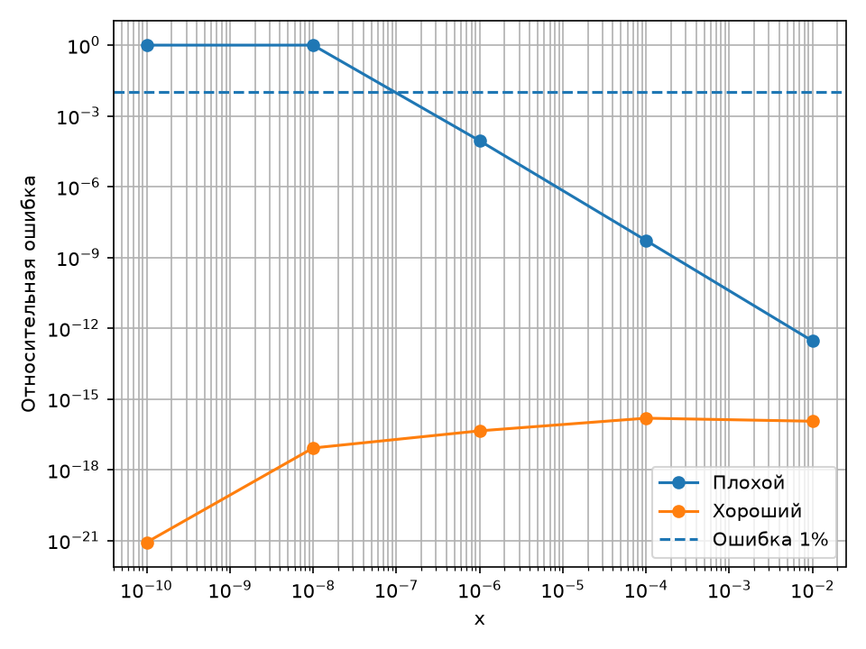
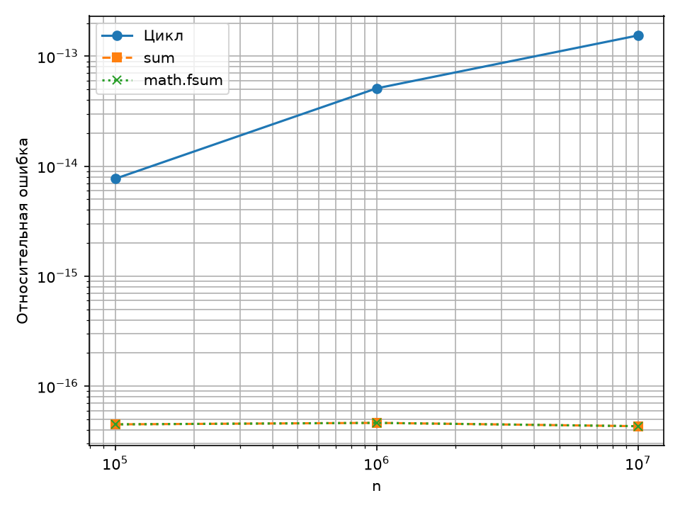
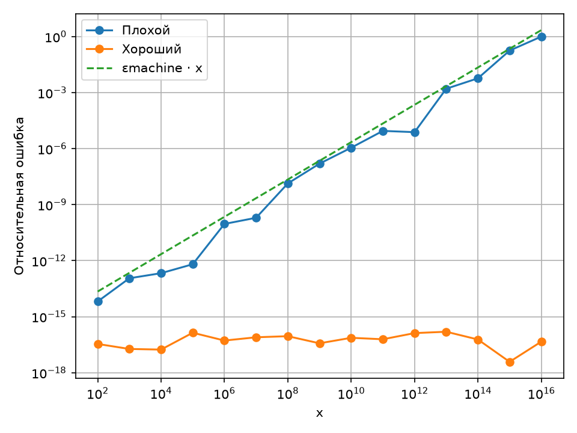

# Домашние задания № 3

## Что надо было сделать

**Формат сдачи:** файл `.py` (или `.ipynb`) с решениями и короткие выводы по каждой задаче (2–3 предложения). Для экспериментальных задач обязательны таблица или график.

### Блок 1. Обусловленность задачи (задачи 1–4)

#### Задача 1. Число обусловленности вручную

Для каждой функции вычислите число обусловленности $\mathrm{cond} = \left| \frac{x \cdot f'(x)}{f(x)} \right|$ в указанной точке и определите, хорошо или плохо обусловлена задача:

1. $f(x) = \sqrt{x}$ при $x = 10^{-8}$
2. $f(x) = \ln x$ при $x = 1.001$
3. $f(x) = x - 1$ при $x = 1.000001$
4. $f(x) = \sin x$ при $x = \pi/2$

*Вывод:* расположите задачи по возрастанию обусловленности. Какая из них самая «опасная» и почему?

#### Задача 2. Вычитание близких чисел как плохая обусловленность

Дана задача $f(a, b) = a - b$. Покажите аналитически, что при $a \approx b$ число обусловленности по $a$ и по $b$ велико. Затем проверьте численно: возьмите $a = 1 + 10^{-8}$, $b = 1$ и посчитайте $\Delta f / \delta a$ при $\delta a = 10^{-9}$. Совпадает ли фактическое изменение результата с предсказанием по $\mathrm{cond}$? Объясните в 2–3 предложениях.

#### Задача 3. Кратные корни — плохая обусловленность

Рассмотрите уравнение $x^2 - 2x + 1 = 0$ (корень $x = 1$ кратности 2). Измените свободный член на $1 - \varepsilon$ для $\varepsilon = 10^{-2}, 10^{-4}, 10^{-6}$. Найдите корни через `math.sqrt` и посмотрите, насколько сдвинулся корень относительно $x = 1$. Постройте таблицу: $\varepsilon$ → сдвиг корня → отношение сдвигов. Сделайте вывод о связи кратности корня и обусловленности.

#### Задача 4. Обусловленность vs устойчивость — различие

Приведите **свой пример** (не из лекции) задачи, которая **хорошо обусловлена**, но для которой можно написать **неустойчивый** алгоритм. Реализуйте оба: устойчивый и неустойчивый варианты, покажите расхождение на диапазоне входных данных. В выводе чётко разделите: «в чём проблема задачи» и «в чём проблема алгоритма».

### Блок 2. Устойчивость алгоритма (задачи 5–9)

#### Задача 5. Квадратное уравнение — классика

Для $a = 1$, $b = 10^8$, $c = 1$ вычислите меньший корень двумя способами:

- «плохо»: $x_2 = \frac{-b + \sqrt{b^2 - 4ac}}{2a}$
- «хорошо»: $x_2 = \frac{2c}{-b - \sqrt{b^2 - 4ac}}$

Сравните с эталоном через `mpmath` (или `decimal` с 50 знаками). Посчитайте относительную погрешность обоих способов. Повторите для $b = 10^4$ и $b = 10^{12}$. Постройте таблицу: $b$ → ошибка плохого → ошибка хорошего. Сделайте вывод: при каком $b$ «плохой» способ начинает катастрофически ошибаться?

#### Задача 6. $(1 - \cos x)$ при малых $x$

Реализуйте два способа вычисления $f(x) = \frac{1 - \cos x}{x^2}$:

- «плохо»: прямо в лоб;
- «хорошо»: через тождество $\frac{2 \cdot \sin^2(x/2)}{x^2}$.

Прогоните $x = 10^{-2}, 10^{-4}, 10^{-6}, 10^{-8}, 10^{-10}$. Эталон — через `mpmath`. Постройте таблицу относительной ошибки обоих способов от $x$ в log-log масштабе. Определите, при каком $x$ ошибка «плохого» способа превышает 1%. Сформулируйте правило, когда нужно искать тригонометрическое тождество.

#### Задача 7. $\sqrt{x+1} - \sqrt{x}$ при больших $x$

Реализуйте два способа:

- «плохо»: $\sqrt{x+1} - \sqrt{x}$;
- «хорошо»: $\frac{1}{\sqrt{x+1} + \sqrt{x}}$.

Прогоните $x = 10^4, 10^8, 10^{12}, 10^{14}, 10^{16}$. Эталон — `mpmath` с 50 знаками. Постройте таблицу относительной ошибки. Определите, как ошибка «плохого» способа растёт с $x$ (оцените показатель степени). Сделайте вывод.

#### Задача 8. Экспонента и логарифм

Для $f(x) = \ln(1 + x)$ при малых $x$ реализуйте:

- «плохо»: `math.log(1 + x)`;
- «хорошо»: `math.log1p(x)`.

Прогоните $x = 10^{-2}, 10^{-8}, 10^{-12}, 10^{-16}$. Эталон — `mpmath.log(1 + x)`. Посчитайте относительную ошибку обоих способов. Объясните, что делает `log1p` внутри (загляните в документацию Python) и почему он устойчив. Сделайте вывод о том, зачем в стандартной библиотеке есть «странные» функции типа `log1p`, `expm1`, `hypot`.

#### Задача 9. Неустойчивость накопления в сумме

Вычислите $S_n = \sum_{k=1}^{n} \frac{1}{k}$ для $n = 10^5, 10^6, 10^7$ тремя способами:

1. наивный цикл слева направо;
2. `sum(arr)`;
3. `math.fsum(arr)`.

Эталон — `mpmath` с 50 знаками. Для каждого $n$ посчитайте относительную ошибку всех трёх способов. Постройте таблицу ошибки от $n$ в log-log. Оцените, как растёт ошибка наивного способа с $n$. Сделайте вывод: при каком $n$ наивная сумма становится неприемлемой (ошибка $> 10^{-10}$)?

### Блок 3. Корректная постановка эксперимента (задачи 10–15)

#### Задача 10. Разделение источников ошибки

Возьмите задачу из задачи 6. Проведите **три** эксперимента:

- (а) меняем $x$, фиксируем алгоритм (плохой) — видим рост ошибки из-за обусловленности/сокращения;
- (б) фиксируем $x$, меняем тип float (float32 через `numpy.float32` vs float64) — видим рост ошибки из-за машинной точности;
- (в) меняем алгоритм (плохой vs хороший), фиксируем $x$ — видим эффект устойчивости.

Оформите таблицу: какой фактор на сколько порядков меняет ошибку. Сформулируйте вывод: какой источник в каждом случае доминирует.

#### Задача 11. Эталон — обязателен

Придумайте (или возьмите из задач 5–9) пример, в котором два **float-результата** совпадают между собой, но **оба неверны** относительно точного эталона. Реализуйте: два алгоритма, сравнение друг с другом через `==`, сравнение каждого с `mpmath`. Сделайте вывод о том, почему сравнивать float с float без эталона — ошибка.

#### Задача 12. Диапазон, а не одна точка

Для функции из задачи 7 прогоните $x$ от $10^2$ до $10^{16}$ (минимум 8 точек, логарифмическая сетка). Постройте график ошибки в log-log. Оцените наклон прямой (показатель степени). Сравните с теоретической оценкой: ошибка «плохого» способа $\approx \varepsilon_{\mathrm{machine}} \cdot x$. Совпадает ли наклон с предсказанием? Сформулируйте вывод о том, зачем нужен диапазон, а не одна точка.

#### Задача 13. Воспроизводимость эксперимента

Напишите эксперимент, который генерирует $10^5$ случайных чисел через `random.seed(42)` и `numpy.random.default_rng(42)`. Суммируйте их тремя способами (`sum`, `math.fsum`, `numpy.sum`). Запустите **дважды** с одним seed — результаты должны совпасть. Запустите с `seed=43` — покажите, что расхождения между способами не «случайны», а систематичны.

Оформите отчёт с указанием: версия Python, версия numpy, seed. Сделайте вывод о том, почему без фиксации seed и версий эксперимент не воспроизводим.

#### Задача 14. Границы представимости

Проверьте поведение наивного суммирования и `fsum` на массиве, содержащем:

- очень большие числа ($\approx 10^{300}$),
- очень маленькие ($\approx 10^{-300}$),
- ноль,
- денормализованные числа ($\approx 10^{-320}$),
- `float('inf')`,
- `float('nan')`.

Что произойдёт с каждым способом? Какой способ «отравится» NaN сразу, а какой — нет? Как ведёт себя `fsum` при наличии `inf`? Оформите таблицу поведения и сделайте вывод: как обрабатывать граничные значения в реальном коде.

#### Задача 15. Полный корректный эксперимент

Выберите **одну** функцию из задач 5–9 и проведите для неё **полноценный** эксперимент по шаблону из лекции:

1. Плохой и хороший алгоритм.
2. Независимый эталон (`mpmath` / `decimal`).
3. Диапазон входных значений (минимум 8 точек, логарифмическая сетка).
4. Таблица: вход → результат плохой → результат хороший → эталон → ошибка плохого → ошибка хорошего.
5. Вывод: где и почему алгоритм неустойчив, при каких входных данных он ещё пригоден, какова достижимая точность.

Оформление — как мини-отчёт: цель, постановка, эталон, результаты, вывод. Это финальная задача, показывающая, что вы умеете ставить численный эксперимент **правильно**.

### Бонус (по желанию)

#### Задача 16. Найди неустойчивость в чужом коде

Найдите в открытом репозитории (GitHub, Stack Overflow) фрагмент кода на Python, где есть потенциальная неустойчивость: вычитание близких чисел, деление на малое, наивная сумма большого массива или ручная реализация `log(1+x)` / `sqrt(x+1)-sqrt(x)`. Приведите код, объясните проблему, предложите устойчивую замену, покажите численно (до/после), что замена помогает. Ссылку на источник — обязательно.

*Главное, что проверяется: умение различать обусловленность задачи и устойчивость алгоритма, находить неустойчивость в формулах, ставить эксперимент с независимым эталоном и диапазоном, и делать выводы, а не просто «запустить и посмотреть».*

## Решение

### Блок 1. Обусловленность задачи

#### Задача 1

```python
def task1():
    tasks = [
        ("1. sqrt(x)", lambda x: math.sqrt(x), lambda x: 1 / (2 * math.sqrt(x)), 1e-8),
        ("2. ln(x)", lambda x: math.log(x), lambda x: 1 / x, 1.001),
        ("3. x - 1", lambda x: x - 1, lambda x: 1, 1.000001),
        ("4. sin(x)", lambda x: math.sin(x), lambda x: math.cos(x), math.pi / 2),
    ]

    for name, f, df, x in tasks:
        cond = abs(x * df(x) / f(x))
        condition = "хорошо обусловлена" if cond <= 1 else "плохо обусловлена"
        print(f"{name:10} | cond = {cond:.4f} | {condition}")
```

```text
1. sqrt(x) | cond = 0.5000 | хорошо обусловлена
2. ln(x)   | cond = 1000.4999 | плохо обусловлена
3. x - 1   | cond = 1000001.0001 | плохо обусловлена
4. sin(x)  | cond = 0.0000 | хорошо обусловлена
```

**Вопрос.** Какая функция сильнее всего реагирует на погрешность входных данных?

**Вывод.** По возрастанию чувствительности идут синус, квадратный корень, логарифм и вычитание единицы. Вычитание единицы оказалось самым чувствительным, потому что ответ близок к нулю.

#### Задача 2

```python
def task2():
    a = 1 + 1e-8
    b = 1.0
    delta_a = 1e-9
    f = a - b
    perturbed_f = (a + delta_a) - b
    delta_f = perturbed_f - f

    cond_a = abs(a / f)
    cond_b = abs(b / f)
    relative_delta_a = abs(delta_a / a)
    relative_delta_f = abs(delta_f / f)
    predicted_relative_delta_f = cond_a * relative_delta_a
    observed_cond_a = relative_delta_f / relative_delta_a

    print("cond_a = |a| / |a − b|, cond_b = |b| / |a − b|")
    print(f"cond_a = {cond_a:.8e}, cond_b = {cond_b:.8e}")
    print(f"f(a, b) = {f:.8e}, f(a + δa, b) = {perturbed_f:.8e}")
    print(f"Относительное изменение a = {relative_delta_a:.8e}")
    print(f"{'Величина':<29} | {'Факт':>14} | {'Прогноз':>14}")
    print(f"{'Δf':<29} | {delta_f:14.8e} | {delta_a:14.8e}")
    print(f"{'Δf / δa':<29} | {delta_f / delta_a:14.8e} | {1:14.8e}")
    print(f"{'|Δf / f|':<29} | {relative_delta_f:14.8e} | {predicted_relative_delta_f:14.8e}")
    print(f"{'|Δf / f| / |δa / a|':<29} | {observed_cond_a:14.8e} | {cond_a:14.8e}")
```

```text
cond_a = |a| / |a − b|, cond_b = |b| / |a − b|
cond_a = 1.00000002e+08, cond_b = 1.00000001e+08
f(a, b) = 9.99999994e-09, f(a + δa, b) = 1.10000000e-08
Относительное изменение a = 9.99999990e-10
Величина                      |           Факт |        Прогноз
Δf                            | 1.00000008e-09 | 1.00000000e-09
Δf / δa                       | 1.00000008e+00 | 1.00000000e+00
|Δf / f|                      | 1.00000009e-01 | 1.00000001e-01
|Δf / f| / |δa / a|           | 1.00000010e+08 | 1.00000002e+08
```

**Вопрос.** Совпадает ли фактическое изменение с прогнозом?

**Вывод.** Результат совпал с прогнозом с небольшим отклонением из-за округления. Если изменить одно из двух близких чисел, их разность изменится на ту же величину, но в процентах это будет гораздо больше.

#### Задача 3

```python
def task3():
    previous_shift = None
    print(f"{'Эпсилон':<12} {'x1':<12} {'x2':<12} {'Сдвиг корня':<16} {'Отношение'}")
    for epsilon in (1e-2, 1e-4, 1e-6):
        a, b, c = 1.0, -2.0, 1.0 - epsilon

        D = b**2 - 4 * a * c

        x1 = (-b + math.sqrt(D)) / (2 * a)
        x2 = (-b - math.sqrt(D)) / (2 * a)

        shift = abs(x1 - 1)

        if previous_shift is None:
            ratio = "-"
        else:
            ratio = f"{previous_shift / shift:.2f}"

        print(f"{epsilon:<12.0e} {x1:<12.6f} {x2:<12.6f} {shift:<16.6f} {ratio}")

        previous_shift = shift
```

```text
Эпсилон      x1           x2           Сдвиг корня      Отношение
1e-02        1.100000     0.900000     0.100000         -
1e-04        1.010000     0.990000     0.010000         10.00
1e-06        1.001000     0.999000     0.001000         10.00
```

**Вывод.** Когда поправка уменьшается в 100 раз, каждый корень сдвигается в 10 раз меньше. Даже небольшое изменение уравнения заметно сдвигает двойной корень.

#### Задача 4

```python
def task4():
    def unstable(x):
        return 1 - 1 / (1 + x)

    def stable(x):
        return x / (1 + x)

    print("f(x) = 1 − 1 / (1 + x) = x / (1 + x), cond = 1 / (1 + x)")
    values = [1e-2, 1e-4, 1e-8, 1e-12, 1e-16, 1e-20]
    print(f"{'x':<10} | {'cond':>12} | {'Неустойчивый':>18} | {'Устойчивый':>18} | {'Расхождение':>18}")
    for x in values:
        a, b = unstable(x), stable(x)
        cond = 1 / (1 + x)
        print(f"{x:<10.0e} | {cond:12.8f} | {a:18.12e} | {b:18.12e} | {abs(a - b):18.12e}")
```

```text
f(x) = 1 − 1 / (1 + x) = x / (1 + x), cond = 1 / (1 + x)
x          |         cond |       Неустойчивый |         Устойчивый |        Расхождение
1e-02      |   0.99009901 | 9.900990099010e-03 | 9.900990099010e-03 | 8.673617379884e-18
1e-04      |   0.99990001 | 9.999000099992e-05 | 9.999000099990e-05 | 1.660184576618e-17
1e-08      |   0.99999999 | 9.999999828203e-09 | 9.999999900000e-09 | 7.179701400345e-17
1e-12      |   1.00000000 | 1.000088900582e-12 | 9.999999999990e-13 | 8.890058334108e-17
1e-16      |   1.00000000 | 0.000000000000e+00 | 1.000000000000e-16 | 1.000000000000e-16
1e-20      |   1.00000000 | 0.000000000000e+00 | 1.000000000000e-20 | 1.000000000000e-20
```

**Вывод.** Задача хорошо обусловлена. При очень малом входном числе первая формула даёт ноль из-за вычитания близких чисел. Вторая формула сохраняет точность.

### Блок 2. Устойчивость алгоритма

#### Задача 5

```python
def task5():
    getcontext().prec = 50

    bad = lambda a, b, c: (-b + math.sqrt(b**2 - 4 * a * c)) / (2 * a)
    good = lambda a, b, c: (2 * c) / (-b - math.sqrt(b**2 - 4 * a * c))

    a, c = 1, 1

    print(f"{'b':<10} | {'Ошибка плохого':<20} | {'Ошибка хорошего':<20}")
    for b in (10**4, 10**8, 10**12):
        x_bad = bad(float(a), float(b), float(c))
        x_good = good(float(a), float(b), float(c))

        a_d, b_d, c_d = Decimal(a), Decimal(b), Decimal(c)
        disc_d = (b_d**2 - Decimal(4) * a_d * c_d).sqrt()
        x_exact = (Decimal(2) * c_d) / (-b_d - disc_d)
        err_bad = relative_error(Decimal.from_float(x_bad), x_exact)
        err_good = relative_error(Decimal.from_float(x_good), x_exact)

        print(f"{b:<10.0e} | {err_bad:<20.3e} | {err_good:<20.3e}")
```

```text
b          | Ошибка плохого       | Ошибка хорошего
1e+04      | 1.118e-09            | 5.651e-17
1e+08      | 2.549e-01            | 7.908e-17
1e+12      | 1.000e+00            | 2.011e-17
```

**Вопрос.** При каком $b$ прямая формула даёт большую ошибку?

**Вывод.** При коэффициенте в 100 миллионов ошибка прямой формулы уже около 25%. При триллионе она достигает 100%. Вторая формула сохраняет точность во всех трёх случаях.

#### Задача 6

```python
def task6():
    mp.mp.dps = 50

    bad = lambda x: (1 - math.cos(x)) / x**2
    good = lambda x: 2 * math.sin(x / 2)**2 / x**2
    ref = lambda x: (1 - mp.cos(x)) / x**2

    nums = [1e-2, 1e-4, 1e-6, 1e-8, 1e-10]
    bad_errors = []
    good_errors = []

    print(f"{'x':>10} | {'Плохой':>15} | {'Хороший':>15}")
    for num in nums:
        reference = ref(mp.mpf(num))
        bad_error = relative_error(bad(num), reference)
        good_error = relative_error(good(num), reference)
        bad_errors.append(bad_error)
        good_errors.append(good_error)
        print(f"{num:10.0e} | {bad_error:15.6e} | {good_error:15.6e}")

    for num, err in zip(nums, bad_errors):
        if err > 0.01:
            print(f"Ошибка превышает 1% при x = {num:.0e}")
            break

    plt.figure("Задача 6. Косинус при малых x")
    plt.loglog(nums, bad_errors, "o-", label="Плохой")
    plt.loglog(nums, good_errors, "o-", label="Хороший")
    plt.axhline(0.01, linestyle="--", label="Ошибка 1%")
    plt.xlabel("x")
    plt.ylabel("Относительная ошибка")
    plt.legend()
    plt.grid(True, which="both")
    plt.tight_layout()
```

```text
         x |          Плохой |         Хороший
     1e-02 |    2.884357e-13 |    1.137148e-16
     1e-04 |    5.244138e-09 |    1.528165e-16
     1e-06 |    8.890058e-05 |    4.441582e-17
     1e-08 |    1.000000e+00 |    8.333333e-18
     1e-10 |    1.000000e+00 |    8.333333e-22
Ошибка превышает 1% при x = 1e-08
```



**Вопрос.** Когда ошибка впервые превышает 1% и когда стоит искать тождество?

**Вывод.** На проверенных точках ошибка прямой формулы впервые превышает один процент при 0,00000001. Формула с синусом сохраняет точность, потому что в ней не нужно вычитать близкие числа.

#### Задача 7

```python
def task7():
    mp.mp.dps = 50
    nums = [1e4, 1e8, 1e12, 1e14, 1e16]
    bad_errors = []

    print(f"{'x':<10} | {'Ошибка плохого':<20} | {'Ошибка хорошего':<20}")
    for num in nums:
        reference = sqrt_ref(mp.mpf(num))
        bad_error = relative_error(sqrt_bad(num), reference)
        good_error = relative_error(sqrt_good(num), reference)
        bad_errors.append(bad_error)
        print(f"{num:<10.0e} | {bad_error:<20.6e} | {good_error:<20.6e}")

    slope = np.polyfit(np.log10(nums[:-1]), np.log10(bad_errors[:-1]), 1)[0]
    print(f"Показатель степени на [1e4, 1e14] = {slope:.3f}")
```

```text
x          | Ошибка плохого       | Ошибка хорошего
1e+04      | 2.130466e-13         | 1.725761e-17
1e+08      | 1.361766e-08         | 9.011403e-17
1e+12      | 7.614494e-06         | 1.317296e-16
1e+14      | 5.828381e-03         | 5.988095e-17
1e+16      | 1.000000e+00         | 4.592256e-17
Показатель степени на [1e4, 1e14] = 0.994
```

**Вывод.** Ошибка прямой формулы растёт примерно пропорционально входному числу. Замена разности корней на формулу с их суммой сохраняет точность даже на больших числах.

#### Задача 8

```python
def task8():
    mp.mp.dps = 50
    print(f"{'x':<10} | {'Ошибка плохого':<20} | {'Ошибка хорошего':<20}")
    for num in [1e-2, 1e-8, 1e-12, 1e-16]:
        reference = mp.log(1 + mp.mpf(num))
        bad_error = relative_error(log_bad(num), reference)
        good_error = relative_error(math.log1p(num), reference)
        print(f"{num:<10.0e} | {bad_error:<20.6e} | {good_error:<20.6e}")
```

```text
x          | Ошибка плохого       | Ошибка хорошего
1e-02      | 9.006115e-16         | 2.892016e-17
1e-08      | 6.077471e-09         | 4.779087e-17
1e-12      | 8.890058e-05         | 2.421794e-17
1e-16      | 1.000000e+00         | 5.000000e-17
```

**Вопрос.** Почему для малых $x$ точнее считать через `log1p`?

**Вывод.** При очень малом входном числе сумма может округлиться до единицы ещё до вычисления логарифма. `log1p` принимает исходное число и сохраняет точность. Для этого и нужны специальные функции вроде `log1p` и `expm1`. [Документация Python](https://docs.python.org/3/library/math.html#math.log1p)

#### Задача 9

```python
def task9():
    mp.mp.dps = 50
    nums = [10**5, 10**6, 10**7]
    naive_errors = []
    sum_errors = []
    fsum_errors = []

    print(f"{'n':>10} | {'Ошибка цикла':>15} | {'Ошибка sum':>15} | {'Ошибка fsum':>15}")
    for n in nums:
        arr = array("d", (1 / k for k in range(1, n + 1)))
        reference = mp.harmonic(n)
        naive_error = relative_error(naive_sum(arr), reference)
        sum_error = relative_error(sum(arr), reference)
        fsum_error = relative_error(math.fsum(arr), reference)
        naive_errors.append(naive_error)
        sum_errors.append(sum_error)
        fsum_errors.append(fsum_error)
        print(f"{n:10d} | {naive_error:15.6e} | {sum_error:15.6e} | {fsum_error:15.6e}")

    slope = np.polyfit(np.log10(nums), np.log10(naive_errors), 1)[0]
    print(f"Показатель степени для цикла = {slope:.3f}")
    above_limit = [n for n, error in zip(nums, naive_errors) if error > 1e-10]
    print(f"n с ошибкой цикла > 1e-10: {above_limit}")

    plt.figure("Задача 9. Гармоническая сумма")
    plt.loglog(nums, naive_errors, "o-", label="Цикл")
    plt.loglog(nums, sum_errors, "s--", label="sum")
    plt.loglog(nums, fsum_errors, "x:", label="math.fsum")
    plt.xlabel("n")
    plt.ylabel("Относительная ошибка")
    plt.legend()
    plt.grid(True, which="both")
    plt.tight_layout()
```

```text
         n |    Ошибка цикла |      Ошибка sum |     Ошибка fsum
    100000 |    7.685060e-15 |    4.490823e-17 |    4.490823e-17
   1000000 |    5.104974e-14 |    4.632451e-17 |    4.632451e-17
  10000000 |    1.545339e-13 |    4.322324e-17 |    4.322324e-17
Показатель степени для цикла = 0.652
n с ошибкой цикла > 1e-10: []
```



**Вопрос.** Превысила ли ошибка цикла $10^{-10}$?

**Вывод.** Ошибка обычного цикла росла, но осталась ниже заданного порога даже на 10 миллионах слагаемых. В этом опыте `sum` и `math.fsum` дали одинаковые результаты.

### Блок 3. Корректная постановка эксперимента

#### Задача 10

```python
def task10():
    mp.mp.dps = 50

    def bad(x):
        one = type(x)(1)
        return (one - np.cos(x)) / (x * x)

    def good(x):
        two = type(x)(2)
        sine = np.sin(x / two)
        return two * sine * sine / (x * x)

    def error(f, x):
        x_mp = mp.mpf(float(x))
        reference = (1 - mp.cos(x_mp)) / x_mp**2
        return relative_error(float(f(x)), reference)

    x64 = np.float64(1e-4)
    experiments = [
        ("x: 1e-2 → 1e-4", error(bad, np.float64(1e-2)), error(bad, x64)),
        ("float64 → float32", error(bad, x64), error(bad, np.float32(x64))),
        ("Плохой → хороший", error(bad, x64), error(good, x64)),
    ]

    print(f"{'Фактор':<20} | {'Ошибка до':>14} | {'Ошибка после':>14} | {'log10(после / до)':>18}")
    for name, before, after in experiments:
        orders = math.log10(after / before)
        print(f"{name:<20} | {before:14.6e} | {after:14.6e} | {orders:+18.3f}")
```

```text
Фактор               |      Ошибка до |   Ошибка после |  log10(после / до)
x: 1e-2 → 1e-4       |   2.884357e-13 |   5.244138e-09 |             +4.260
float64 → float32    |   5.244138e-09 |   1.000000e+00 |             +8.280
Плохой → хороший     |   5.244138e-09 |   1.528165e-16 |             -7.536
```

**Вывод.** На меньшем входном числе вычитание близких значений увеличило ошибку примерно на четыре порядка. Переход на `float32` увеличил её ещё примерно на восемь порядков. Формула с синусом снизила ошибку примерно на семь с половиной порядков.

#### Задача 11

```python
def task11():
    mp.mp.dps = 50
    x = 1e16
    a = sqrt_bad(x)
    b = math.sqrt(x) * (math.sqrt(1 + 1 / x) - 1)
    reference = sqrt_ref(mp.mpf(x))

    print(f"x = {x:.0e}, a == b: {a == b}, эталон = {mp.nstr(reference, 20)}")
    print(f"{'Алгоритм':<33} | {'Результат':>14} | {'Ошибка':>14}")
    print(f"{'sqrt(x + 1) − sqrt(x)':<33} | {a:14.6e} | {relative_error(a, reference):14.6e}")
    print(f"{'sqrt(x) · (sqrt(1 + 1/x) − 1)':<33} | {b:14.6e} | {relative_error(b, reference):14.6e}")
```

```text
x = 1e+16, a == b: True, эталон = 4.999999999999999875e-9
Алгоритм                          |      Результат |         Ошибка
sqrt(x + 1) − sqrt(x)             |   0.000000e+00 |   1.000000e+00
sqrt(x) · (sqrt(1 + 1/x) − 1)     |   0.000000e+00 |   1.000000e+00
```

**Вывод.** Оба способа дали ноль, хотя эталон был отличен от нуля. Ошибка у обоих составила 100%. Одинаковые результаты ещё не означают, что ответ верный.

#### Задача 12

```python
def task12():
    mp.mp.dps = 50
    nums = np.logspace(2, 16, 15)
    bad_errors = []
    good_errors = []

    for num in nums:
        reference = sqrt_ref(mp.mpf(float(num)))
        bad_errors.append(relative_error(sqrt_bad(num), reference))
        good_errors.append(relative_error(sqrt_good(num), reference))

    slope = np.polyfit(np.log10(nums[:-2]), np.log10(bad_errors[:-2]), 1)[0]
    print(f"Наклон на [1e2, 1e14] = {slope:.3f}, теоретический наклон = 1")

    plt.figure("Задача 12. Разность корней на диапазоне x")
    plt.loglog(nums, bad_errors, "o-", label="Плохой")
    plt.loglog(nums, good_errors, "o-", label="Хороший")
    plt.loglog(nums, np.finfo(float).eps * nums, "--", label="εmachine · x")
    plt.xlabel("x")
    plt.ylabel("Относительная ошибка")
    plt.legend()
    plt.grid(True, which="both")
    plt.tight_layout()
```

```text
Наклон на [1e2, 1e14] = 1.017, теоретический наклон = 1
```



**Вопрос.** Совпадает ли измеренный наклон с теорией?

**Вывод.** Наклон получился почти равным единице, как и ожидалось. По графику видно, как ошибка растёт и на самой большой точке достигает 100%. Одна точка такой картины не даёт.

#### Задача 13

```python
def task13():
    def experiment(seed):
        random.seed(seed)
        rng = np.random.default_rng(seed)
        return {
            "random": [random.uniform(-1, 1) for _ in range(10**5)],
            "default_rng": rng.uniform(-1, 1, 10**5).tolist(),
        }

    print(f"n = {10**5}")
    print(
        f"{'seed':>4} | {'Генератор':<12} | {'Запуск':>6} | "
        f"{'sum':>22} | {'math.fsum':>22} | {'numpy.sum':>22} | "
        f"{'sum − fsum':>12} | {'numpy − fsum':>12}"
    )
    for seed, run in [(42, 1), (42, 2), (43, 1)]:
        for name, values in experiment(seed).items():
            total = sum(values)
            precise = math.fsum(values)
            numpy_total = np.sum(values)
            print(
                f"{seed:4d} | {name:<12} | {run:6d} | "
                f"{total:22.17g} | {precise:22.17g} | {numpy_total:22.17g} | "
                f"{total - precise:12.3e} | {numpy_total - precise:12.3e}"
            )
```

```text
n = 100000
seed | Генератор    | Запуск |                    sum |              math.fsum |              numpy.sum |   sum − fsum | numpy − fsum
  42 | random       |      1 |     28.858423255620394 |     28.858423255620394 |     28.858423255620359 |    0.000e+00 |   -3.553e-14
  42 | default_rng  |      1 |     124.98733243174503 |     124.98733243174503 |       124.987332431745 |    0.000e+00 |   -2.842e-14
  42 | random       |      2 |     28.858423255620394 |     28.858423255620394 |     28.858423255620359 |    0.000e+00 |   -3.553e-14
  42 | default_rng  |      2 |     124.98733243174503 |     124.98733243174503 |       124.987332431745 |    0.000e+00 |   -2.842e-14
  43 | random       |      1 |     191.36179179051831 |     191.36179179051831 |     191.36179179051828 |    0.000e+00 |   -2.842e-14
  43 | default_rng  |      1 |   -0.91480521945010662 |   -0.91480521945010662 |   -0.91480521945014459 |    0.000e+00 |   -3.797e-14
```

**Среда эксперимента.** Python 3.15.2, NumPy 2.5.4. Два запуска с `seed=42`, один с `seed=43`.

**Вывод.** При начальном значении 42 оба запуска дали одинаковые результаты. При значении 43 суммы изменились, а разница между способами осталась примерно такой же. Для повторения опыта нужны начальное значение генератора и версии Python и NumPy.

#### Задача 14

```python
def task14():
    finite = [1e300, 1e-300, 0.0, 1e-320, -1e300]
    cases = [
        ("Большие", [1e300, 1e300]),
        ("Малые", [1e-300, 1e-300]),
        ("Ноль", [0.0]),
        ("Денормализованные", [1e-320, 1e-320]),
        ("Смесь конечных", finite),
        ("Смесь с inf", finite + [math.inf]),
        ("Смесь с -inf", finite + [-math.inf]),
        ("Смесь с nan", finite[:2] + [math.nan] + finite[2:]),
        ("Смесь с inf и nan", finite + [math.inf, math.nan]),
        ("Смесь с inf и -inf", finite + [math.inf, -math.inf]),
    ]

    print(f"{'Набор':<22} | {'Цикл':>15} | {'math.fsum':>15}")
    for name, values in cases:
        try:
            precise = f"{math.fsum(values):.6e}"
        except ValueError as error:
            precise = type(error).__name__
        print(f"{name:<22} | {naive_sum(values):15.6e} | {precise:>15}")
```

```text
Набор                  |            Цикл |       math.fsum
Большие                |   2.000000e+300 |   2.000000e+300
Малые                  |   2.000000e-300 |   2.000000e-300
Ноль                   |    0.000000e+00 |    0.000000e+00
Денормализованные      |   1.999978e-320 |   1.999978e-320
Смесь конечных         |    0.000000e+00 |   1.000000e-300
Смесь с inf            |             inf |             inf
Смесь с -inf           |            -inf |            -inf
Смесь с nan            |             nan |             nan
Смесь с inf и nan      |             nan |             nan
Смесь с inf и -inf     |             nan |      ValueError
```

**Вопрос.** Что произойдёт с суммой при `nan` и `inf`?

**Вывод.** При `nan` оба способа вернули `nan`. Если бесконечности одного знака, оба способа сохраняют этот знак. При бесконечностях разных знаков цикл даёт `nan`, а `math.fsum` сообщает об ошибке. Если нужны только конечные числа, их можно проверить перед суммированием.

#### Задача 15

```python
def task15():
    mp.mp.dps = 50
    nums = np.logspace(-16, -2, 15)

    print("f(x) = ln(1 + x), эталон mpmath с 50 знаками")
    print(
        f"{'x':>10} | {'Плохой':>21} | {'Хороший':>21} | {'Эталон':>21} | "
        f"{'Ошибка плохого':>15} | {'Ошибка хорошего':>15}"
    )
    for num in nums:
        x = float(num)
        bad = log_bad(x)
        good = math.log1p(x)
        reference = mp.log(1 + mp.mpf(x))
        bad_error = relative_error(bad, reference)
        good_error = relative_error(good, reference)
        print(
            f"{x:10.0e} | {bad:21.14e} | {good:21.14e} | {mp.nstr(reference, 15):>21} | "
            f"{bad_error:15.6e} | {good_error:15.6e}"
        )
```

```text
f(x) = ln(1 + x), эталон mpmath с 50 знаками
         x |                Плохой |               Хороший |                Эталон |  Ошибка плохого | Ошибка хорошего
     1e-16 |  0.00000000000000e+00 |  1.00000000000000e-16 |               1.0e-16 |    1.000000e+00 |    5.000000e-17
     1e-15 |  1.11022302462516e-15 |  1.00000000000000e-15 |               1.0e-15 |    1.102230e-01 |    1.055695e-16
     1e-14 |  9.99200722162636e-15 |  9.99999999999995e-15 |  9.99999999999995e-15 |    7.992778e-04 |    4.870979e-17
     1e-13 |  9.99200722162591e-14 |  9.99999999999950e-14 |   9.9999999999995e-14 |    7.992778e-04 |    1.084447e-16
     1e-12 |  1.00008890058184e-12 |  9.99999999999500e-13 |    9.999999999995e-13 |    8.890058e-05 |    2.421794e-17
     1e-11 |  1.00000008273537e-11 |  9.99999999995000e-12 |     9.99999999995e-12 |    8.274037e-08 |    8.062072e-17
     1e-10 |  1.00000008269037e-10 |  9.99999999950000e-11 |      9.9999999995e-11 |    8.274037e-08 |    3.389513e-17
     1e-09 |  1.00000008224037e-09 |  9.99999999500000e-10 |       9.999999995e-10 |    8.274037e-08 |    7.493897e-17
     1e-08 |  9.99999988922529e-09 |  9.99999995000000e-09 |         9.99999995e-9 |    6.077471e-09 |    4.779087e-17
     1e-07 |  9.99999950583870e-08 |  9.99999950000003e-08 |   9.99999950000003e-8 |    5.838672e-10 |    7.363643e-17
     1e-06 |  9.99999499918067e-07 |  9.99999500000333e-07 |   9.99999500000333e-7 |    8.226657e-11 |    6.645867e-17
     1e-05 |  9.99995000039884e-06 |  9.99995000033333e-06 |   9.99995000033333e-6 |    6.551009e-12 |    1.455387e-16
     1e-04 |  9.99950003332973e-05 |  9.99950003333083e-05 |   9.99950003333083e-5 |    1.101939e-13 |    6.374435e-18
     1e-03 |  9.99500333083423e-04 |  9.99500333083533e-04 |  0.000999500333083533 |    1.100321e-13 |    3.899051e-17
     1e-02 |  9.95033085316809e-03 |  9.95033085316808e-03 |   0.00995033085316808 |    9.006115e-16 |    2.892016e-17
```

**Постановка.** Сравниваем относительную ошибку двух способов вычисления $\ln(1+x)$ на 15 логарифмически распределённых точках от $10^{-16}$ до $10^{-2}$. Эталон даёт `mpmath` с 50 знаками точности.

**Вывод.** На двух самых малых входных значениях ошибка прямой формулы превысила один процент. На самой малой точке она вернула ноль, потому что сумма округлилась до единицы. `log1p` сохранила точность на всей проверенной сетке.
