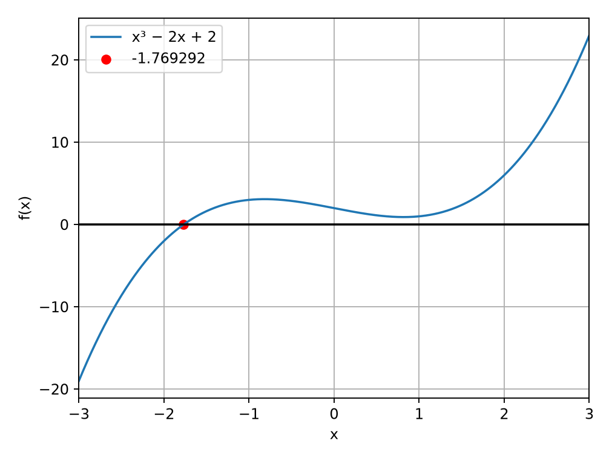

# Практическая по занятию № 9

## Что надо было сделать

В [задаче 1](newton-and-secant-methods.md#задача-1-сравнить-методы-на-функции-с-плохим-стартом)

## Решение

### Задача 1

```python
def task1():
    f = lambda x: x**3 - 2 * x + 2
    df = lambda x: 3 * x**2 - 2

    _, journal_bad, status_bad = newton(f, df, 0)
    root_n, journal_n, _ = newton(f, df, -2)
    root_s, journal_s, _ = secant(f, -2, -1)

    bisection_log = []

    def logged_f(x):
        y = f(x)
        bisection_log.append((x, y))
        return y

    root_b, iterations_b = bisection(logged_f, -2, -1)

    print_journal_newton(journal_bad, "Ньютон, x0 = 0")
    print_journal_newton(journal_n, "Ньютон, x0 = -2")
    print_journal_secant(journal_s, "Секущие, x0 = -2, x1 = -1")

    print("\nБисекция")

    for k, (x, y) in enumerate(bisection_log[2:], start=1):
        print(f"{k:3} | {x: .12f} | {y: .3e}")

    print("\nМетод    | Старт   | Корень          | Итераций")
    print(f"Ньютон   | 0       | {status_bad:15} | {len(journal_bad)}")
    print(f"Ньютон   | -2      | {root_n: .12f} | {len(journal_n)}")
    print(f"Секущие  | -2, -1  | {root_s: .12f} | {len(journal_s)}")
    print(f"Бисекция | [-2,-1] | {root_b: .12f} | {iterations_b}")

    xs = [i / 100 for i in range(-300, 300+1)]
    plt.plot(xs, [f(x) for x in xs], label="x³ − 2x + 2")
    plt.axhline(0, color="black")
    plt.scatter([root_b], [0], color="red", label=f"{root_b:.6f}")
    plt.xlabel("x")
    plt.ylabel("f(x)")
    plt.grid()
    plt.legend()
    plt.show()
```

<details>
<summary>Вывод task1()</summary>

```text
=== Ньютон, x0 = 0 ===
  k |              x |           f(x) |          f'(x) |        шаг
----------------------------------------------------------------------
  1 |   0.0000000000 |      2.000e+00 |     -2.000e+00 |   1.00e+00
  2 |   1.0000000000 |      1.000e+00 |      1.000e+00 |   1.00e+00
  3 |   0.0000000000 |      2.000e+00 |     -2.000e+00 |   1.00e+00
  4 |   1.0000000000 |      1.000e+00 |      1.000e+00 |   1.00e+00
  5 |   0.0000000000 |      2.000e+00 |     -2.000e+00 |   1.00e+00
  6 |   1.0000000000 |      1.000e+00 |      1.000e+00 |   1.00e+00
  7 |   0.0000000000 |      2.000e+00 |     -2.000e+00 |   1.00e+00
  8 |   1.0000000000 |      1.000e+00 |      1.000e+00 |   1.00e+00
  9 |   0.0000000000 |      2.000e+00 |     -2.000e+00 |   1.00e+00
 10 |   1.0000000000 |      1.000e+00 |      1.000e+00 |   1.00e+00
 11 |   0.0000000000 |      2.000e+00 |     -2.000e+00 |   1.00e+00
 12 |   1.0000000000 |      1.000e+00 |      1.000e+00 |   1.00e+00
 13 |   0.0000000000 |      2.000e+00 |     -2.000e+00 |   1.00e+00
 14 |   1.0000000000 |      1.000e+00 |      1.000e+00 |   1.00e+00
 15 |   0.0000000000 |      2.000e+00 |     -2.000e+00 |   1.00e+00
 16 |   1.0000000000 |      1.000e+00 |      1.000e+00 |   1.00e+00
 17 |   0.0000000000 |      2.000e+00 |     -2.000e+00 |   1.00e+00
 18 |   1.0000000000 |      1.000e+00 |      1.000e+00 |   1.00e+00
 19 |   0.0000000000 |      2.000e+00 |     -2.000e+00 |   1.00e+00
 20 |   1.0000000000 |      1.000e+00 |      1.000e+00 |   1.00e+00
 21 |   0.0000000000 |      2.000e+00 |     -2.000e+00 |   1.00e+00
 22 |   1.0000000000 |      1.000e+00 |      1.000e+00 |   1.00e+00
 23 |   0.0000000000 |      2.000e+00 |     -2.000e+00 |   1.00e+00
 24 |   1.0000000000 |      1.000e+00 |      1.000e+00 |   1.00e+00
 25 |   0.0000000000 |      2.000e+00 |     -2.000e+00 |   1.00e+00
 26 |   1.0000000000 |      1.000e+00 |      1.000e+00 |   1.00e+00
 27 |   0.0000000000 |      2.000e+00 |     -2.000e+00 |   1.00e+00
 28 |   1.0000000000 |      1.000e+00 |      1.000e+00 |   1.00e+00
 29 |   0.0000000000 |      2.000e+00 |     -2.000e+00 |   1.00e+00
 30 |   1.0000000000 |      1.000e+00 |      1.000e+00 |   1.00e+00
 31 |   0.0000000000 |      2.000e+00 |     -2.000e+00 |   1.00e+00
 32 |   1.0000000000 |      1.000e+00 |      1.000e+00 |   1.00e+00
 33 |   0.0000000000 |      2.000e+00 |     -2.000e+00 |   1.00e+00
 34 |   1.0000000000 |      1.000e+00 |      1.000e+00 |   1.00e+00
 35 |   0.0000000000 |      2.000e+00 |     -2.000e+00 |   1.00e+00
 36 |   1.0000000000 |      1.000e+00 |      1.000e+00 |   1.00e+00
 37 |   0.0000000000 |      2.000e+00 |     -2.000e+00 |   1.00e+00
 38 |   1.0000000000 |      1.000e+00 |      1.000e+00 |   1.00e+00
 39 |   0.0000000000 |      2.000e+00 |     -2.000e+00 |   1.00e+00
 40 |   1.0000000000 |      1.000e+00 |      1.000e+00 |   1.00e+00
 41 |   0.0000000000 |      2.000e+00 |     -2.000e+00 |   1.00e+00
 42 |   1.0000000000 |      1.000e+00 |      1.000e+00 |   1.00e+00
 43 |   0.0000000000 |      2.000e+00 |     -2.000e+00 |   1.00e+00
 44 |   1.0000000000 |      1.000e+00 |      1.000e+00 |   1.00e+00
 45 |   0.0000000000 |      2.000e+00 |     -2.000e+00 |   1.00e+00
 46 |   1.0000000000 |      1.000e+00 |      1.000e+00 |   1.00e+00
 47 |   0.0000000000 |      2.000e+00 |     -2.000e+00 |   1.00e+00
 48 |   1.0000000000 |      1.000e+00 |      1.000e+00 |   1.00e+00
 49 |   0.0000000000 |      2.000e+00 |     -2.000e+00 |   1.00e+00
 50 |   1.0000000000 |      1.000e+00 |      1.000e+00 |   1.00e+00
 51 |   0.0000000000 |      2.000e+00 |     -2.000e+00 |   1.00e+00
 52 |   1.0000000000 |      1.000e+00 |      1.000e+00 |   1.00e+00
 53 |   0.0000000000 |      2.000e+00 |     -2.000e+00 |   1.00e+00
 54 |   1.0000000000 |      1.000e+00 |      1.000e+00 |   1.00e+00
 55 |   0.0000000000 |      2.000e+00 |     -2.000e+00 |   1.00e+00
 56 |   1.0000000000 |      1.000e+00 |      1.000e+00 |   1.00e+00
 57 |   0.0000000000 |      2.000e+00 |     -2.000e+00 |   1.00e+00
 58 |   1.0000000000 |      1.000e+00 |      1.000e+00 |   1.00e+00
 59 |   0.0000000000 |      2.000e+00 |     -2.000e+00 |   1.00e+00
 60 |   1.0000000000 |      1.000e+00 |      1.000e+00 |   1.00e+00
 61 |   0.0000000000 |      2.000e+00 |     -2.000e+00 |   1.00e+00
 62 |   1.0000000000 |      1.000e+00 |      1.000e+00 |   1.00e+00
 63 |   0.0000000000 |      2.000e+00 |     -2.000e+00 |   1.00e+00
 64 |   1.0000000000 |      1.000e+00 |      1.000e+00 |   1.00e+00
 65 |   0.0000000000 |      2.000e+00 |     -2.000e+00 |   1.00e+00
 66 |   1.0000000000 |      1.000e+00 |      1.000e+00 |   1.00e+00
 67 |   0.0000000000 |      2.000e+00 |     -2.000e+00 |   1.00e+00
 68 |   1.0000000000 |      1.000e+00 |      1.000e+00 |   1.00e+00
 69 |   0.0000000000 |      2.000e+00 |     -2.000e+00 |   1.00e+00
 70 |   1.0000000000 |      1.000e+00 |      1.000e+00 |   1.00e+00
 71 |   0.0000000000 |      2.000e+00 |     -2.000e+00 |   1.00e+00
 72 |   1.0000000000 |      1.000e+00 |      1.000e+00 |   1.00e+00
 73 |   0.0000000000 |      2.000e+00 |     -2.000e+00 |   1.00e+00
 74 |   1.0000000000 |      1.000e+00 |      1.000e+00 |   1.00e+00
 75 |   0.0000000000 |      2.000e+00 |     -2.000e+00 |   1.00e+00
 76 |   1.0000000000 |      1.000e+00 |      1.000e+00 |   1.00e+00
 77 |   0.0000000000 |      2.000e+00 |     -2.000e+00 |   1.00e+00
 78 |   1.0000000000 |      1.000e+00 |      1.000e+00 |   1.00e+00
 79 |   0.0000000000 |      2.000e+00 |     -2.000e+00 |   1.00e+00
 80 |   1.0000000000 |      1.000e+00 |      1.000e+00 |   1.00e+00
 81 |   0.0000000000 |      2.000e+00 |     -2.000e+00 |   1.00e+00
 82 |   1.0000000000 |      1.000e+00 |      1.000e+00 |   1.00e+00
 83 |   0.0000000000 |      2.000e+00 |     -2.000e+00 |   1.00e+00
 84 |   1.0000000000 |      1.000e+00 |      1.000e+00 |   1.00e+00
 85 |   0.0000000000 |      2.000e+00 |     -2.000e+00 |   1.00e+00
 86 |   1.0000000000 |      1.000e+00 |      1.000e+00 |   1.00e+00
 87 |   0.0000000000 |      2.000e+00 |     -2.000e+00 |   1.00e+00
 88 |   1.0000000000 |      1.000e+00 |      1.000e+00 |   1.00e+00
 89 |   0.0000000000 |      2.000e+00 |     -2.000e+00 |   1.00e+00
 90 |   1.0000000000 |      1.000e+00 |      1.000e+00 |   1.00e+00
 91 |   0.0000000000 |      2.000e+00 |     -2.000e+00 |   1.00e+00
 92 |   1.0000000000 |      1.000e+00 |      1.000e+00 |   1.00e+00
 93 |   0.0000000000 |      2.000e+00 |     -2.000e+00 |   1.00e+00
 94 |   1.0000000000 |      1.000e+00 |      1.000e+00 |   1.00e+00
 95 |   0.0000000000 |      2.000e+00 |     -2.000e+00 |   1.00e+00
 96 |   1.0000000000 |      1.000e+00 |      1.000e+00 |   1.00e+00
 97 |   0.0000000000 |      2.000e+00 |     -2.000e+00 |   1.00e+00
 98 |   1.0000000000 |      1.000e+00 |      1.000e+00 |   1.00e+00
 99 |   0.0000000000 |      2.000e+00 |     -2.000e+00 |   1.00e+00
100 |   1.0000000000 |      1.000e+00 |      1.000e+00 |   1.00e+00

=== Ньютон, x0 = -2 ===
  k |              x |           f(x) |          f'(x) |        шаг
----------------------------------------------------------------------
  1 |  -2.0000000000 |     -2.000e+00 |      1.000e+01 |   2.00e-01
  2 |  -1.8000000000 |     -2.320e-01 |      7.720e+00 |   3.01e-02
  3 |  -1.7699481865 |     -4.850e-03 |      7.398e+00 |   6.56e-04
  4 |  -1.7692926629 |     -2.281e-06 |      7.391e+00 |   3.09e-07
  5 |  -1.7692923542 |     -5.054e-13 |      7.391e+00 |   6.84e-14

=== Секущие, x0 = -2, x1 = -1 ===
  k |         x_prev |         x_curr |         f_curr |        шаг
----------------------------------------------------------------------
  1 |  -2.0000000000 |  -1.0000000000 |      3.000e+00 |   6.00e-01
  2 |  -1.0000000000 |  -1.6000000000 |      1.104e+00 |   3.49e-01
  3 |  -1.6000000000 |  -1.9493670886 |     -1.509e+00 |   2.02e-01
  4 |  -1.9493670886 |  -1.7476129346 |      1.578e-01 |   1.91e-02
  5 |  -1.7476129346 |  -1.7667091237 |      1.906e-02 |   2.62e-03
  6 |  -1.7667091237 |  -1.7693330951 |     -3.011e-04 |   4.08e-05
  7 |  -1.7693330951 |  -1.7692922786 |      5.594e-07 |   7.57e-08
  8 |  -1.7692922786 |  -1.7692923542 |      1.637e-11 |   2.21e-12
  9 |  -1.7692923542 |  -1.7692923542 |      0.000e+00 |   0.00e+00

Бисекция
  1 | -1.500000000000 |  1.625e+00
  2 | -1.750000000000 |  1.406e-01
  3 | -1.875000000000 | -8.418e-01
  4 | -1.812500000000 | -3.293e-01
  5 | -1.781250000000 | -8.914e-02
  6 | -1.765625000000 |  2.703e-02
  7 | -1.773437500000 | -3.073e-02
  8 | -1.769531250000 | -1.766e-03
  9 | -1.767578125000 |  1.265e-02
 10 | -1.768554687500 |  5.449e-03
 11 | -1.769042968750 |  1.843e-03
 12 | -1.769287109375 |  3.877e-05
 13 | -1.769409179688 | -8.636e-04
 14 | -1.769348144531 | -4.124e-04
 15 | -1.769317626953 | -1.868e-04
 16 | -1.769302368164 | -7.402e-05
 17 | -1.769294738770 | -1.762e-05
 18 | -1.769290924072 |  1.057e-05
 19 | -1.769292831421 | -3.527e-06
 20 | -1.769291877747 |  3.522e-06
 21 | -1.769292354584 | -2.551e-09
 22 | -1.769292116165 |  1.760e-06
 23 | -1.769292235374 |  8.785e-07
 24 | -1.769292294979 |  4.380e-07
 25 | -1.769292324781 |  2.177e-07
 26 | -1.769292339683 |  1.076e-07
 27 | -1.769292347133 |  5.252e-08
 28 | -1.769292350858 |  2.498e-08
 29 | -1.769292352721 |  1.122e-08
 30 | -1.769292353652 |  4.333e-09
 31 | -1.769292354118 |  8.910e-10
 32 | -1.769292354351 | -8.299e-10
 33 | -1.769292354234 |  3.058e-11
 34 | -1.769292354293 | -3.996e-10
 35 | -1.769292354264 | -1.845e-10
 36 | -1.769292354249 | -7.698e-11
 37 | -1.769292354242 | -2.320e-11
 38 | -1.769292354238 |  3.689e-12
 39 | -1.769292354240 | -9.755e-12
 40 | -1.769292354239 | -3.033e-12
 41 | -1.769292354239 |  3.286e-13

Метод    | Старт   | Корень          | Итераций
Ньютон   | 0       | max_iter        | 100
Ньютон   | -2      | -1.769292354239 | 5
Секущие  | -2, -1  | -1.769292354239 | 9
Бисекция | [-2,-1] | -1.769292354239 | 41
```

</details>



График пересекает ось $x$ один раз, около $x=-1.769292$.

### Вопрос

Почему метод Ньютона со стартом $x_0=0$ застревает?

Первый шаг даёт 1, а второй 0, и так повторяется бесконечно. Поэтому он не сходится к корню.